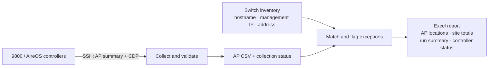

# AP Locator

[](https://github.com/bleekley/ap-locator/actions/workflows/tests.yml)
[](LICENSE)

**Turn Cisco access-point inventory into a per-site location report.**

AP Locator collects AP and CDP neighbor information from Cisco Catalyst 9800 and
legacy AireOS wireless controllers, then matches the neighboring switch against
your switch inventory to infer the AP's street address. It is a small Python CLI
for discovery, migration planning, and inventory reconciliation.

No switch logins are needed for the normal collection path. Location accuracy
depends on CDP availability and the quality of your switch-to-address inventory;
this is not an RF positioning or floor-plan tool.



## Start here

- [User guide](docs/TRAINING.md): installation, credentials, collection, reports, and troubleshooting.
- [Lab setup and validation](docs/LAB.md): CML2 context, physical APs, topology diagrams, and test boundaries.
- [Workflow and matching rules](docs/WORKFLOW.md): data flow and failure handling.
- [Contributing](CONTRIBUTING.md): run tests and add sanitized parser fixtures.

## Quick start

Requires Python 3.10 or newer and SSH reachability to your controllers.

```bash
git clone https://github.com/bleekley/ap-locator.git
cd ap-locator
python3 -m venv .venv
source .venv/bin/activate
python -m pip install -r requirements.txt
cp .env.example .env
cp controllers.example.csv controllers.csv
```

Edit `.env` with your credentials and `controllers.csv` with your controller
names, management addresses, and types (`9800` or `aireos`). Then:

```bash
python src/collect.py
python src/correlate.py path/to/switch_inventory.xlsx
```

Switch inventory accepts `.xlsx` or `.csv` with these columns:

| hostname | mgmt_ip | street_address |
|---|---|---|
| sw-building-a | 192.0.2.30 | 100 Example Avenue, Example City |
| sw-building-b | 192.0.2.31 | 200 Example Avenue, Example City |

Open `output/ap_location_report.xlsx`. Review **Run Summary** and **Controller
Status** before using the site totals. Additional inventory columns are retained
as `inventory_<column>` on matched AP rows.

For PowerShell setup and credential overrides, see the [user guide](docs/TRAINING.md).

## Try it without a network

```bash
python examples/offline_demo.py
```

The demo uses synthetic 9800 fixtures and fictional addresses. It writes a
clearly labeled workbook under `output/demo/`, without SSH or credentials.
It does not overwrite a normal collection. Open its AP Locations sheet to see
one matched AP and one AP requiring manual follow-up.

## What the report tells you

| Sheet | Purpose |
|---|---|
| Run Summary | Collection completeness, source, UTC timestamps, AP and match counts |
| Controller Status | Every requested controller, outcome, AP count, and failure category |
| AP Locations | Model, wired MAC, IP, CDP neighbor/port, inferred address, match method/status |
| Per-Site Summary | AP counts and model families by address, including an UNKNOWN bucket |

- Missing or duplicate controller entries are rejected before collection.
- CLI errors and discrepancies with controller-declared AP counts fail collection.
- A checksum binds the AP CSV to its collection status file.
- Reports block incomplete collections unless you explicitly use `--allow-partial`.
- Ambiguous matches and missing addresses stay unresolved and remain in totals.
- Optional MAC tracing follows switch neighbors but never treats missing CDP as proof of an access port.

`COMPLETE` means all listed controllers collected successfully. It does **not**
mean every AP has a known address, every AP in the organization was discovered,
or that the model is compatible with a proposed migration target.

## Validation and limitations

Originally exercised in a CML2-connected lab with a Catalyst 9800, an AireOS
2504, and physical APs. The public fixtures include a sanitized AireOS capture
and explicitly synthetic 9800 examples. Offline tests cover collection failures,
matching, workbook output, and mocked switch traversal.

The reliability changes have passed offline regression tests; they still need a
fresh live lab run. Real multi-switch MAC tracing remains unverified. See the
[validation matrix](docs/LAB.md#validation-matrix) before operational use.

Supported parser formats are narrower than the full Cisco software portfolio.
IPv6-only neighbor discovery, LLDP, mesh location inference, and automatic
replacement/rejoin classification are not implemented. Verify the intended
controller release's Cisco compatibility matrix separately.

## Development

```bash
python -m unittest discover -s src -p 'test_*.py'
```

Tests run offline and require no device access. GitHub Actions runs them across
Python versions. Never include `.env`, actual controller lists, customer
inventories, raw captures, or generated reports in an issue or pull request.

## License

[MIT](LICENSE). Community project; not affiliated with or endorsed by Cisco.
