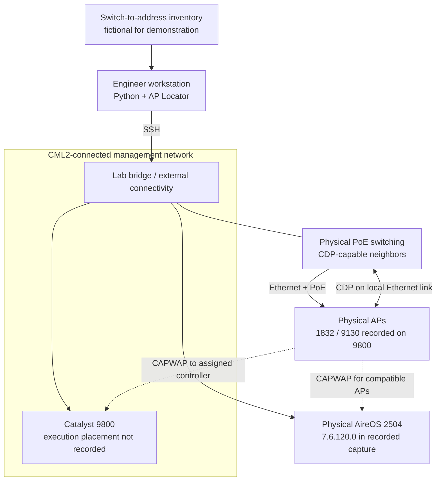
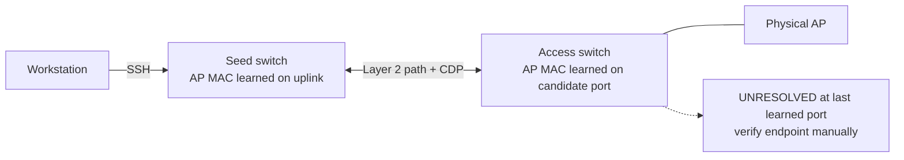

# Lab setup and validation

[Back to README](../README.md) · [User guide](TRAINING.md)

## What was exercised

The original development environment combined Cisco Modeling Labs 2 (CML2)
connectivity with a Catalyst 9800 controller, an AireOS 2504, and physical access
points. Project notes record six real APs on the 9800 (three 1832 and three
9130), followed by a mixed-controller collection after onboarding the 2504.
The 2504 capture was recorded on AireOS 7.6.120.0.

The exact CML export, node images, interface mappings, and 9800 software release
were not retained in this repository. The diagram below describes the logical
roles; it is not a verified port-by-port reconstruction or an importable CML lab.
No Cisco software images or device configurations are distributed here.

## Logical topology

The AP hears its neighbor's CDP advertisements on the physical Ethernet link
and exposes that information through its controller. CML provides the connected
lab context; it does not replace the physical AP/switch relationship being
measured. The original unmanaged CML bridge could not exercise managed-switch
MAC-table traversal.

## Reproduce an equivalent lab

1. Provide an isolated management network that the Python workstation can reach
   by SSH. Use your own addressing; `controllers.example.csv` contains documentation
   addresses and is not a usable live configuration.
2. Connect a supported Catalyst 9800 deployment and, if testing the legacy path,
   a physical AireOS controller such as a 2504. Use images/licenses obtained
   through your own Cisco entitlement.
3. Connect compatible physical APs to a CDP-capable PoE switch. Verify AP joining,
   controller clock, reachability, and CDP before running the tool. Consult
   Cisco's documentation for the exact AP/controller software pairing.
4. Record the exact controller models/releases, AP models, and switch releases.
   These details are essential when comparing CLI output formats.
5. Populate a switch inventory with the switch's advertised management IP,
   hostname, and a fictional lab address. If the advertised address differs from
   the management address in your inventory, expect hostname matching or an exception.
6. Follow the [user guide](TRAINING.md) to collect and correlate. Compare parsed
   counts with `show ap summary`, then compare every AP's neighbor and port with
   manual observations. Do not infer physical correctness from a green process exit.

For the initial exercise, include a matching AP, a missing inventory row, and a
switch with a blank address. Confirm all APs remain counted and unresolved ones
are visible. Then fail one controller's SSH connection and confirm that normal
report generation refuses the incomplete run.

## MAC tracing extension

This is an additional topology to build and validate, not a completed live test.

Use a seed in the AP's Layer 2 forwarding path; a routed core may not know its
MAC. Check each hop against switch MAC tables. The implementation follows a
unique switch CDP neighbor with a management address. Missing CDP, multiple
neighbors, ambiguous MAC entries, and loops stop the trace. Port-channel CDP
behavior varies; do not assume a port channel can be traversed.

The current command intentionally provides investigative leads, not a verified
endpoint verdict. Confirm the interface, downstream topology, and AP identity
manually. Test CDP-disabled links specifically: the tool must not print `FOUND`.

## Validation matrix

| Area | Evidence retained | Status |
|---|---|---|
| 9800 collection | Prior notes: 6 physical APs, 3×1832 + 3×9130 | Historical live result; current parser examples are synthetic |
| AireOS collection | Prior mixed-fleet run; sanitized 2504 CDP capture | Historical live result; captured format covered offline |
| CLI failures and count mismatches | Mocked connections and parser regressions | Automated offline |
| IP / hostname / short-name matching | Synthetic inventory tests | Automated offline |
| Ambiguous or addressless matches | Exceptions and site-total regressions | Automated offline |
| Partial, empty, and mismatched runs | Workbook and provenance regressions | Automated offline |
| Multi-switch traversal | Mocked two-switch connection sequence | Offline only; live path outstanding |
| Reliability changes from 2026-10-06 | Regression suite | Fresh live validation outstanding |

No claim of broad Cisco platform certification is made. A live test result from
one release does not establish support for all AireOS or IOS XE formats.

## Fixture provenance

See [fixtures/README.md](../fixtures/README.md). Public captures have identifiers
replaced; examples and street addresses are fictional. No raw customer inventory,
controller credentials, or original private lab captures are included.

## Legacy SSH note

The development environment used `paramiko<4` for compatibility with its legacy
AireOS SSH behavior. This pin records a tested dependency constraint; it does not
establish that all failures on newer Paramiko releases have the same cause.
Keep legacy-controller access inside your approved management network. If SSH
fails, capture sanitized error details, controller release, and dependency versions
before changing cryptographic settings.
