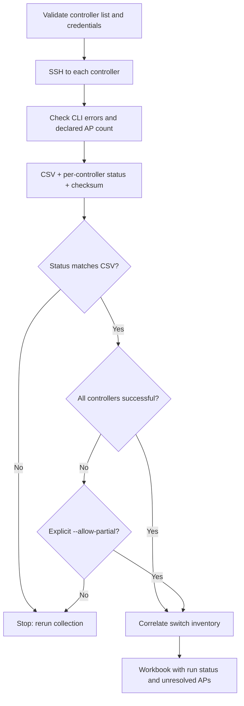
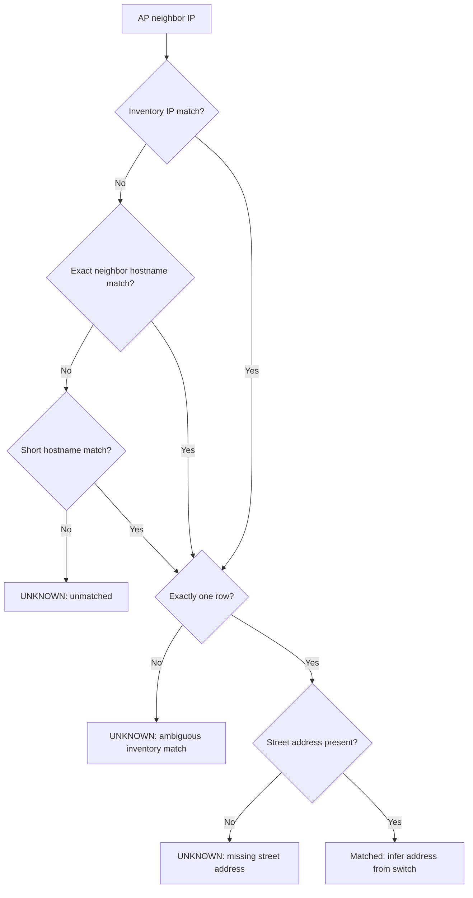

# Workflow and matching rules

[Back to README](../README.md) · [User guide](TRAINING.md) · [Lab setup](LAB.md)

## Collection to report

`collect.py` opens one SSH connection per controller and merges AP summary rows
with CDP data by AP name. It collects controllers sequentially and attempts the
remaining controllers after an ordinary connection/command failure. Credentials
are checked before any collection begins. Summary parsers must recognize the
declared AP total and return that many distinct AP names.

The collector writes the CSV and JSON through temporary files. The report checks
the CSV's SHA-256 against JSON metadata, catching an interrupted replacement or
manual CSV changes. This is a consistency check, not authentication or tamper-proof
storage. Run a single writer in an output directory; concurrent runs are unsupported.

## Address resolution

Hostname matching is case-insensitive. DNS suffix stripping applies to the AP's
neighbor name, so a short inventory hostname can match an advertised FQDN. IP
matching uses stripped text. Empty values cannot match other empty values.
An ambiguous stronger key does not fall through to weaker matching. Identical
duplicate rows are still ambiguous and should be resolved in the inventory.

The report does not cross-validate conflicting IP and hostname evidence or
verify that the physical AP shares its neighbor's street address. Inventory
freshness and topology remain operator responsibilities.

## Output contract

- `ap_inventory.csv`: `controller`, `ap_name`, `model`, `eth_mac`, `ap_ip`,
  `state`, `neighbor_name`, `neighbor_ip`, `neighbor_port`.
- `collection_status.json`: UTC start/end, collection source, completeness,
  inventory checksum, and each requested controller's outcome/count/error category.
- `ap_location_report.xlsx`: Run Summary, Controller Status, AP Locations,
  and Per-Site Summary. Data sheets retain collection status, source and timestamp.
- Location statuses: `matched`, `unmatched`, `ambiguous inventory match`,
  `missing street address`. All unresolved APs appear in the UNKNOWN site bucket.
- Extra inventory fields are normalized and copied as `inventory_<column>`.
- Zero-AP collections are valid and generate an empty workbook with headers/status.

A nonzero collection exit indicates failure. Correlation blocks missing status,
checksum mismatch and incomplete collection unless a partial report is explicitly
requested. A failed report attempt leaves any earlier workbook in place; check
its timestamp before using it. Command details are printed locally; persisted
controller errors contain the exception category only.

## Scope and limitations

The tool uses IPv4-oriented CLI parsers and CDP. It has no LLDP fallback or mesh
location model. It inventories the APs visible in the returned summaries. AP
compatibility, lifecycle decisions, physical verification, and offline AP discovery
are outside the report's scope. The MAC trace is a manual-investigation aid and
requires a separate switch login; its last learned port is not confirmed placement.

See [lab validation](LAB.md#validation-matrix) for evidence and outstanding live tests.
